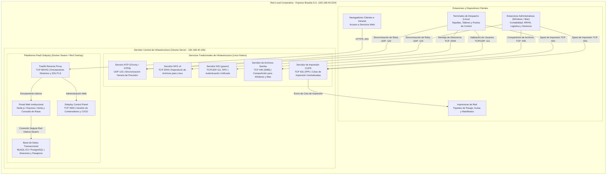

# Documento de Análisis y Diseño de Infraestructura de TI

**Institución:** Universidad del Quindío  
**Facultad:** Facultad de Ingeniería de Sistemas y Computación  
**Curso:** Administración de Infraestructura de TI  
**Semestre:** 2026-1  
**Docente:** Maycol Cárdenas Acevedo  
**Estudiantes / Equipo Consultor:** Leonardo Gallego Ríos (Leo) & Keren  
**Servidor Implementado:** `MV1` (Ubuntu 24.04.4 LTS — Kernel 6.17.0-23-generic)  
**Empresa Seleccionada:** EXPRESO BRASILIA S.A.  
**Entregable:** Semana 1 - Análisis y Diseño de Servicios de Infraestructura  

---

## 1. Contexto Empresarial: Expreso Brasilia S.A.

**Expreso Brasilia S.A.** es una de las empresas de transporte terrestre intermunicipal, especial y de logística de carga/encomiendas más representativas de Colombia. Fundada en Barranquilla en 1961, cuenta con una cobertura que supera los 750 destinos a nivel nacional y rutas internacionales hacia países vecinos. 

Su modelo operativo integra múltiples unidades de negocio y locaciones físicas:
* **Agencias y Taquillas en Terminales:** Puntos de atención al público donde se expiden tiquetes de viaje, se gestionan reservas y se atiende el abordaje de pasajeros.
* **Centros de Despacho y Puestos de Control:** Áreas operativas donde se autoriza la salida de los buses, se controlan los turnos de los conductores y se monitorea la telemetría vehicular en ruta.
* **Talleres y Patios de Mantenimiento:** Instalaciones dedicadas a la revisión técnico-mecánica de la flota de autobuses, donde se utilizan terminales de diagnóstico y gestión de repuestos.
* **Sedes Administrativas y Financieras:** Oficinas donde operan los departamentos de Contabilidad, Talento Humano, Jurídico, Facturación y Gerencia General.

---

## 2. Diagnóstico de Necesidades y Justificación de Servicios

El director de tecnología y operaciones de Expreso Brasilia S.A. requiere consolidar en un servidor local centralizado la plataforma de servicios que soporte la operación diaria. La infraestructura debe garantizar alta disponibilidad, seguridad, trazabilidad legal y soporte para entornos operativos heterogéneos (Linux y Windows/Mac).

A continuación se fundamenta técnicamente la adopción de cada uno de los servicios propuestos:

### 2.1 Servicio Web Institucional y Portal de Pasajeros (Dokploy PaaS)
* **Función en la empresa:** Portal corporativo para la consulta de itinerarios, disponibilidad de cupos, cotización de tarifas, radicación de PQRs y seguimiento en línea de encomiendas.
* **Justificación técnica:** Se despliega como un microservicio en contenedores administrado por **Dokploy**. Esta aproximación permite aislar la aplicación del sistema operativo base, escalar instancias según la temporada turística (semana santa, vacaciones, festivos) y garantizar despliegues continuos sin caída de servicio (*zero-downtime*).

### 2.2 Base de Datos Relacional Transaccional (Dokploy PaaS)
* **Función en la empresa:** Almacén central de datos de itinerarios de ruta, asignación de asientos por bus, registro de conductores y registro transaccional de ventas.
* **Justificación técnica:** Se implementa un motor relacional (MySQL 8.0 / PostgreSQL) empaquetado y gestionado mediante Dokploy. Su acceso queda restringido exclusivamente a la red *overlay* interna de Docker, evitando la exposición pública de puertos de base de datos hacia internet y facilitando políticas automáticas de respaldo (*snapshots* y copias a almacenamiento S3).

### 2.3 Traefik Reverse Proxy y Terminación SSL/TLS (Dokploy Ingress)
* **Función en la empresa:** Punto de entrada seguro a todas las aplicaciones web institucionales de la empresa.
* **Justificación técnica:** Traefik gestiona de forma nativa y automatizada los certificados criptográficos SSL/TLS (mediante Let's Encrypt o certificados institucionales), asegurando que todas las comunicaciones de los pasajeros y empleados viajen cifradas mediante HTTPS (puerto 443), protegiendo la información de transacciones y datos personales bajo la Ley 1581 de 2012 (Habeas Data).

### 2.4 Servicio NTP (Network Time Protocol)
* **Función en la empresa:** Servidor central de sincronización horaria de precisión para todas las taquillas, servidores, torniquetes y sistemas de rastreo GPS de los buses.
* **Justificación técnica:** En el sector de transporte de pasajeros por carretera, el sellado de tiempo (*timestamp*) en los tiquetes de pasaje, turnos de despacho y manifiestos de viaje es un requisito legal no negociable exigido por la **Superintendencia de Transporte** y el Ministerio de Transporte. El servicio NTP garantiza que ningún equipo local sufra desincronización horaria, previniendo disputas operativas y asegurando la consistencia forense de los logs de auditoría.

### 2.5 Servicio NFS (Network File System v4)
* **Función en la empresa:** Sistema de archivos en red de alto rendimiento para estaciones de trabajo con sistema operativo Linux ubicadas en talleres mecánicos y puestos de despacho.
* **Justificación técnica:** Permite centralizar manuales de mantenimiento de las carrocerías y chasis de buses (Marcopolo, Scania, Mercedes-Benz), diagnósticos de escáner vehicular y volcados de logs de telemetría sin requerir replicar gigabytes de información en cada equipo local. NFS v4 ofrece comunicación nativa basada en TCP, eficiente y transparente en entornos Linux.

### 2.6 Servicio NIS (Network Information Service / Yellow Pages)
* **Función en la empresa:** Directorio de autenticación y gestión unificada de cuentas de usuario para los operadores y despachadores de las terminales.
* **Justificación técnica:** Las terminales de transporte operan las 24 horas del día en múltiples turnos. Con NIS, un despachador o supervisor puede iniciar sesión en cualquier estación Linux de la red corporativa utilizando sus credenciales institucionales únicas, sin necesidad de crear cuentas locales manuales en cada terminal.

### 2.7 Servicio CUPS (Common Unix Printing System)
* **Función en la empresa:** Servidor centralizado de colas de impresión para tiquetes de viaje, rótulos térmicos de equipaje, manifiestos de carga y facturas de remesas.
* **Justificación técnica:** CUPS expone las impresoras de la empresa a través del estándar IPP (Internet Printing Protocol). Permite auditar el volumen de impresión, gestionar prioridades en colas de despacho y brindar compatibilidad multiplataforma transparente para imprimir tanto desde terminales Linux como desde computadores Windows.

### 2.8 Servicio Samba (SMB/CIFS)
* **Función en la empresa:** Compartición segura de archivos y carpetas institucionales para el personal administrativo (Finanzas, Contabilidad, Recursos Humanos, Jurídico).
* **Justificación técnica:** El personal administrativo utiliza sistemas operativos Windows 10/11 y macOS. Samba permite interoperar de manera nativa con el protocolo SMB, definiendo carpetas compartidas con permisos restrictivos basados en grupos de usuarios (`@contabilidad`, `@operaciones`, `@gerencia`), garantizando confidencialidad y control de acceso.

---

## 3. Tabla Formal de Requisitos Técnicos de Infraestructura

A continuación se detalla la matriz de configuración de red, puertos, protocolos y tipos de servicio planificados para el servidor central de **Expreso Brasilia S.A.**:

| Servicio | Nombre / Software | Plataforma | IP Servidor | Puerto(s) | Protocolo de Transporte / Aplicación | Función en Expreso Brasilia S.A. |
|---|---|---|---|---|---|---|
| **Gestor PaaS** | Dokploy Panel | Dokploy | `192.168.40.100` | 3000 | TCP / HTTP | Consola gráfica de administración y orquestación de contenedores |
| **Proxy Inverso / SSL** | Traefik v2.10 | Dokploy | `192.168.40.100` | 80, 443 | TCP / HTTP, HTTPS (TLS 1.3) | Puerta de enlace segura con terminación SSL y enrutamiento dinámico |
| **Web Institucional** | Webapp Expreso Brasilia | Dokploy (Docker) | `192.168.40.100` | 443 (interno: 3000) | TCP / HTTPS | Portal web corporativo para consulta de rutas e itinerarios de viaje |
| **Base de Datos** | MySQL 8.0 / PostgreSQL | Dokploy (Docker) | Red Interna Swarm | 3306 / 5432 | TCP / SQL | Repositorio transaccional de pasajes, despachos y flota |
| **Sincronización Tiempo** | NTP Daemon / Chrony | Linux Nativo | `192.168.40.100` | 123 | UDP / NTPv4 | Sincronización horaria exacta de taquillas, GPS y servidores |
| **Archivos Linux** | NFS Kernel Server v4 | Linux Nativo | `192.168.40.100` | 2049, 111 | TCP, UDP / NFS, RPC | Repositorio central de manuales y telemetría para estaciones Linux |
| **Autenticación Usuarios** | NIS (`ypserv`, `ypbind`) | Linux Nativo | `192.168.40.100` | 111, puertos RPC | TCP, UDP / Portmapper, RPC | Autenticación centralizada de operadores de taquilla y despacho |
| **Servidor de Impresión** | CUPS (`cupsd`) | Linux Nativo | `192.168.40.100` | 631 | TCP / IPP, HTTPS | Administración de colas de impresión de tiquetes y manifiestos |
| **Archivos Windows/Mac** | Samba (`smbd`, `nmbd`) | Linux Nativo | `192.168.40.100` | 445, 139 | TCP / SMB, CIFS, NetBIOS | Compartición de documentos contables y administrativos para Windows |

*Nota: La dirección IP `192.168.40.100` corresponde al host servidor en la red de pruebas local (modo puente en el segmento `192.168.40.0/24`), parametrizable de manera transparente a cualquier segmento LAN institucional (`192.168.1.0/24` o `10.0.0.0/24`).*

---

## 4. Plan de Direccionamiento de Red y Segmentación

Para estructurar la topología de red de la sede operativa de Expreso Brasilia S.A., se establece el siguiente esquema de direccionamiento IPv4 bajo una máscara de subred `/24` (255.255.255.0):

* **Identificador de Subred:** `192.168.40.0/24`
* **Puerta de Enlace (Router / Gateway):** `192.168.40.1`
* **Servidor DNS Primario:** `192.168.40.1` (o DNS institucional de respaldo `1.1.1.1`)
* **Servidor Central de Infraestructura:** `192.168.40.100` (Nombre FQDN: `srv-infra.brasilia.local`)
  - Aloja los 5 servicios nativos de Linux (NTP, NFS, NIS, CUPS, Samba).
  - Aloja la plataforma Dokploy, Traefik, aplicación web y base de datos.
* **Rango Estático para Impresoras y Periféricos:** `192.168.40.20` – `192.168.40.49`
* **Rango Dinámico DHCP para Terminales de Despacho (Linux):** `192.168.40.101` – `192.168.40.150`
* **Rango Dinámico DHCP para Clientes Administrativos (Windows/Mac):** `192.168.40.151` – `192.168.40.200`
* **Dirección de Broadcast:** `192.168.40.255`

---

## 5. Diagrama de Arquitectura de Infraestructura

El siguiente diagrama modela la interacción entre las estaciones cliente, los servicios nativos del sistema operativo y los servicios alojados en la plataforma PaaS Dokploy dentro de la red corporativa de Expreso Brasilia S.A.:

---

## 6. Consideraciones de Seguridad y Endurecimiento

1. **Aislamiento de Bases de Datos:** El motor de base de datos no publicará su puerto TCP (3306/5432) hacia la interfaz de red pública del servidor. La comunicación con la aplicación web se efectuará estrictamente a través de la red *overlay* interna de Docker Swarm, mitigando ataques de fuerza bruta o inyecciones directas desde la red local.
2. **Filtrado de Paquetes con UFW:** Se configurará el cortafuegos perimetral del servidor (`ufw`) permitiendo únicamente los puertos estrictamente declarados en la tabla de requisitos (80, 443, 3000, 123, 2049, 111, 631, 445) y SSH para administración por clave pública.
3. **Control de Acceso Basado en Roles (RBAC):** Las carpetas compartidas en Samba y NFS implementarán listas de control de acceso y separación de grupos (`sambausers`, `despachadores`, `mantenimiento`).
4. **Respaldos Automatizados:** Implementación de scripts programados en `cron` para volcado de esquemas de bases de datos y respaldos de configuraciones críticas (`/etc/exports`, `/etc/samba/smb.conf`, `/etc/ntp.conf`).

---

## 7. Plan de Ejecución para las Siguientes Fases

* **Semana 2 (Infraestructura Base):** Aprovisionamiento de la máquina virtual Ubuntu Server 24.04 LTS (2 vCPUs, 4GB RAM, 40GB disco en modo puente), configuración de IP fija, instalación desatendida de Dokploy, configuración del demonio NTP y generación de certificados SSL/TLS con Traefik.
* **Semana 3 (Servicios de Infraestructura):** Implementación técnica y validación funcional de NFS, NIS, CUPS, Samba, despliegue del portal web y conexión a base de datos en Dokploy.
* **Semana 4 (Documentación Final y Sustentación):** Consolidación de bitácora técnica con capturas de pantalla de pruebas funcionales, análisis costo-beneficio y sustentación oral en vivo (15 minutos).
