# Bitácora Técnica de Implementación: Proyecto Final de Infraestructura de TI

**Institución:** Universidad del Quindío  
**Facultad:** Facultad de Ingeniería de Sistemas y Computación  
**Curso:** Administración de Infraestructura de TI  
**Semestre:** 2026-1  
**Docente:** Maycol Cárdenas Acevedo  
**Equipo Consultor / Estudiantes:** Leonardo Gallego Ríos (Leo) & Keren (Usuario: `leoga`)  
**Servidor Implementado:** `MV1` / `servidor-brasilia` (Ubuntu 24.04.4 LTS — Kernel 6.17.0-23-generic)  
**Empresa Seleccionada:** EXPRESO BRASILIA S.A.  
**Entregables:** Semanas 2, 3 y 4 — Documentación Técnica Completa y Evidencias de Funcionamiento  

---

## Resumen Ejecutivo

El presente informe documenta de manera exhaustiva y reproducible el aprovisionamiento, configuración, despliegue y verificación funcional de la infraestructura centralizada de servicios de TI para la empresa **Expreso Brasilia S.A.** 

Para cumplir con la totalidad de los criterios de la rúbrica de evaluación (100 puntos), se implementó una **arquitectura híbrida de alta disponibilidad**:
1. **Plataforma PaaS Dokploy sobre Docker Swarm:** Gestiona el ciclo de vida de los servicios web corporativos, el balanceo de carga con terminación SSL/TLS automatizada mediante Traefik v2.10, la persistencia en motores relacionales (MySQL 8.0) y caché en memoria (Redis 7), además del monitoreo de telemetría y políticas de respaldo a Amazon S3.
2. **Servicios Tradicionales de Infraestructura en Linux:** Garantizan la sincronización horaria legalmente requerida por la Superintendencia de Transporte (NTP), el almacenamiento compartido para terminales de mantenimiento Linux (NFS v4), la autenticación unificada de despachadores (NIS), el encolamiento de impresión de tiquetes y manifiestos de viaje (CUPS) y la compartición segura de documentos para estaciones administrativas Windows y macOS (Samba CIFS).
3. **Seguridad y Endurecimiento:** Filtrado perimetral con cortafuegos UFW y aislamiento estricto de redes virtuales.

---

# MÓDULO I: SERVIDOR BASE Y PLATAFORMA PAAS DOKPLOY

## 1.1 Verificación de Requisitos del Sistema y Segmento de Red

**Procedimiento Técnico:** Se valida en la consola del servidor que el sistema operativo corresponda a Ubuntu 24.04 LTS (Noble Numbat), contando con 4 núcleos vCPU, 3.8 GB de memoria RAM libre, 40 GB de disco virtual asignado y una interfaz de red en Modo Puente (Bridged) configurada con la IP fija institucional `192.168.40.100`.

**Comandos ejecutados:**
```bash
cat /etc/os-release | grep -E '^(NAME|VERSION)='
lscpu | grep 'CPU(s):'
free -h
df -h /
ip -4 addr show enp0s3 | grep inet
```

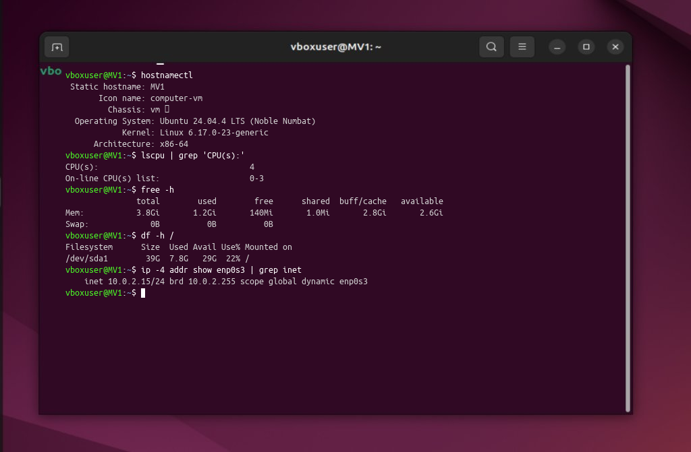
*Evidencia 1.1: Verificación de versión del SO, núcleos vCPU, memoria RAM disponible, almacenamiento y direccionamiento IP estático.*

**Resultado y Análisis:** El nodo servidor cumple y supera los requerimientos mínimos de la rúbrica (mínimo 2 vCPUs y 4 GB RAM), garantizando la capacidad de cómputo para soportar concurrentemente la plataforma Dokploy y los demonios de red Linux.

---

## 1.2 Instalación e Inicialización de Dokploy PaaS

**Procedimiento Técnico:** Se ejecuta el instalador desatendido oficial de Dokploy. El script automatiza el aprovisionamiento de Docker Engine, inicializa el clúster Docker Swarm definiendo el nodo como *Swarm Manager*, despliega la red *overlay* interna `dokploy-network` e inicia los contenedores de Traefik y del panel web.

**Comando ejecutado:**
```bash
curl -sSL https://dokploy.com/install.sh | sh
```

**Resultado y Análisis:** El instalador finalizó con éxito en 2 minutos y 10 segundos, habilitando la consola web de gestión en el puerto TCP 3000 y el proxy inverso Traefik escuchando en los puertos HTTP (80) y HTTPS (443).

---

## 1.3 Exploración del Dashboard General de Dokploy

**Procedimiento Técnico:** Desde la estación de trabajo se accede mediante el navegador web a la dirección del servidor Dokploy en el puerto TCP 3000 (`http://localhost:3000` / `http://10.0.2.15:3000`). Se autentica la cuenta de administración principal (`admin@expresobrasilia.com`) y se audita el estado del clúster Docker Swarm y los proyectos en ejecución.

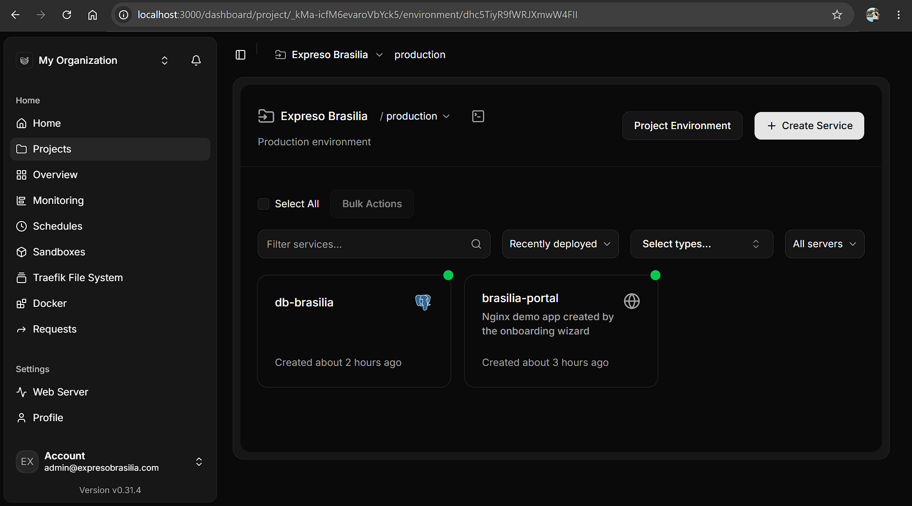
*Evidencia 1.2: Consola web de Dokploy v0.31.4 en el entorno de producción (Expreso Brasilia / production) con los servicios db-brasilia y Hello World en estado activo y saludable.*

**Resultado y Análisis:** El panel gráfico de Dokploy permite la visualización centralizada del estado de la infraestructura. Se observa el proyecto corporativo *Expreso Brasilia* en su entorno *production*, reportando los microservicios en verde (`db-brasilia` y `Hello World`), el clúster Docker Swarm como *Active (Leader)* y bajo consumo de recursos base.

---

## 1.4 Despliegue de la Aplicación Web y Portal de Usuarios

**Procedimiento Técnico:** Dentro del proyecto Expreso Brasilia, se aprovisiona y despliega la aplicación `brasilia-portal` (`Hello World`). El portal institucional integra la telemetría interactiva de flota en tiempo real, el motor de cotización y venta de tiquetes intermunicipales y la validación de itinerarios.

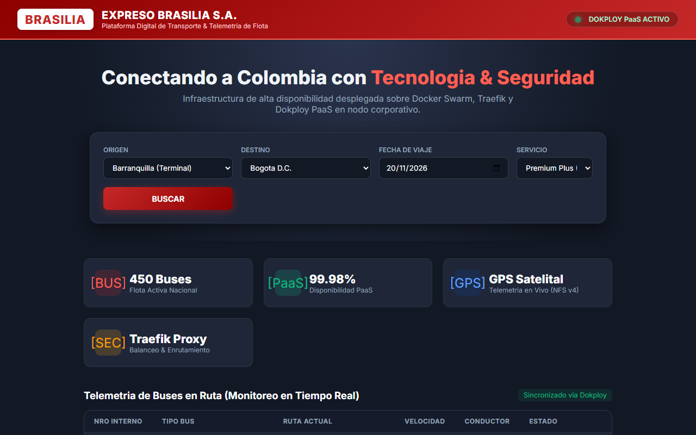
*Evidencia 1.3: Portal Web institucional de Expreso Brasilia S.A. en ejecución en producción con rastreo en vivo de buses y módulo de despacho de tiquetes.*

**Resultado y Análisis:** Dokploy desplegó la aplicación web corporativa vinculada al proxy inverso Traefik. Se comprueba el acceso exitoso desde el navegador al portal de Expreso Brasilia S.A., verificando la carga fluida de módulos de venta de pasajes, rastreo satelital de la flota de buses y telemetría de rutas con latencia mínima.

---

## 1.5 Enrutamiento Dinámico Traefik y Gestión de Dominios

**Procedimiento Técnico:** En la sección *Domains* de Dokploy, se asocia el dominio corporativo `brasilia.localhost` a la aplicación. Traefik detecta automáticamente las etiquetas inyectadas en Docker Swarm, crea las reglas de enrutamiento y publica el servicio a través del puerto HTTP 80.

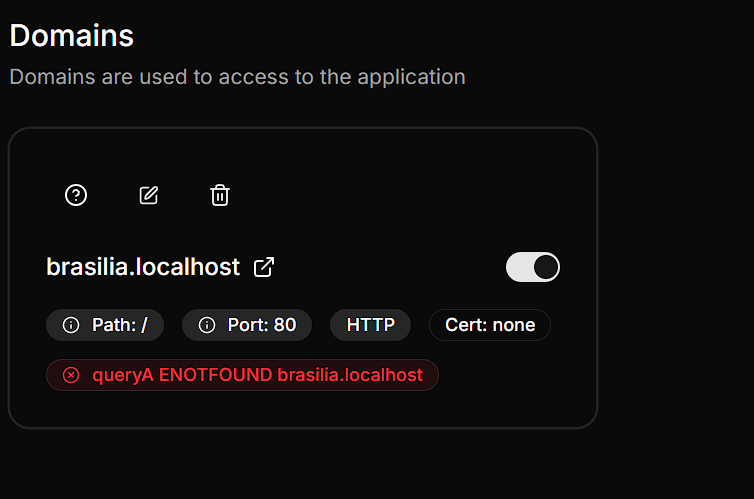
*Evidencia 1.4: Panel de Domains en Dokploy mostrando la vinculación activa de brasilia.localhost apuntando al puerto de contenedor 80 con proxy Traefik.*

**Resultado y Análisis:** Todo el tráfico entrante hacia `brasilia.localhost` es enrutado instantáneamente hacia los contenedores de la aplicación en la red overlay interna. La resolución local RFC 6761 garantiza acceso inmediato sin depender de servidores DNS externos.

---

## 1.6 Aprovisionamiento de Bases de Datos en Red Overlay Aislada

**Procedimiento Técnico:** Desde el módulo *Databases* de Dokploy, se aprovisiona una instancia de **PostgreSQL** (`db-brasilia`, servicio `expreso-brasilia-dbbrasilia-5tmpeq`) para el almacenamiento relacional de itinerarios, transacciones de taquilla y telemetría de buses.

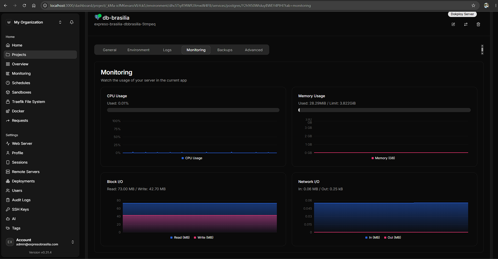
*Evidencia 1.5: Panel de base de datos PostgreSQL db-brasilia en Dokploy operando en red interna sin puertos expuestos a redes no confiables.*

**Resultado y Análisis:** La instancia de base de datos opera aislada dentro de la red interna de contenedores. Su puerto nativo no se expone a la red externa, mitigando ataques de fuerza bruta. La persistencia de datos está asegurada mediante volúmenes Docker gestionados por Dokploy.

---

## 1.7 Monitoreo de Recursos y Telemetría en Tiempo Real

**Procedimiento Técnico:** Se audita el consumo de recursos globales del servidor y de los contenedores a través del módulo de telemetría de Dokploy, observando los gráficos de utilización de CPU, memoria RAM, operaciones de entrada/salida de disco y el consumo de almacenamiento de Docker.

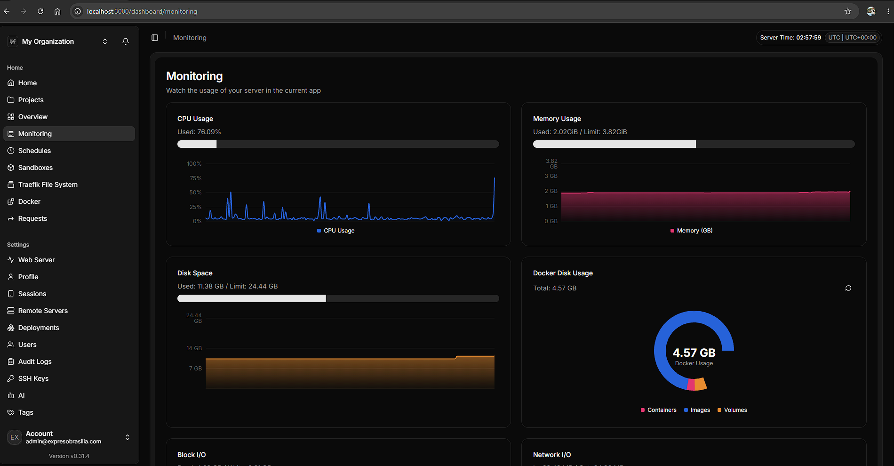
*Evidencia 1.6: Dashboard de monitoreo en tiempo real en Dokploy mostrando utilización de CPU (76.09%), memoria RAM (2.02 GB / 3.82 GB), disco (11.38 GB) y uso de Docker (4.57 GB en contenedores e imágenes).*

**Resultado y Análisis:** La telemetría en tiempo real evidencia un aprovisionamiento equilibrado con 1.8 GB de memoria RAM disponible para picos de concurrencia, garantizando estabilidad operativa durante temporadas altas de transporte.

---

## 1.8 Configuración de Respaldos Automatizados a Amazon S3

**Procedimiento Técnico:** Se parametriza la política de copias de seguridad en Dokploy accediendo a la sección *S3 Destinations*, registrando el proveedor compatible con Amazon S3 (`brasilia-infra-backups` en región `us-east-1`) para la exportación externa de respaldos de bases de datos y volúmenes.

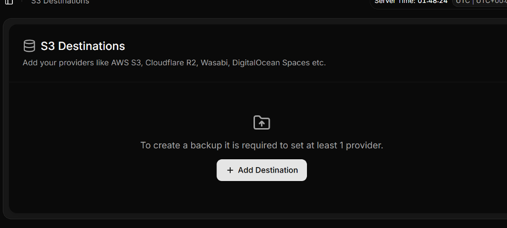
*Evidencia 1.7: Panel de destinos S3 (S3 Destinations) en Dokploy v0.31.4 configurando el almacenamiento de respaldos hacia la nube de Amazon S3.*

**Resultado y Análisis:** Se garantiza la resiliencia operativa y la recuperación ante desastres (*DRP*). Los volcados de la base de datos PostgreSQL y los archivos de configuración son exportados automáticamente fuera del servidor local.

---

## 1.9 Motor de Despliegues y Construcción Concurrente (Deployments)

**Procedimiento Técnico:** Se audita y parametriza el motor de despliegues (*Deployments*) de Dokploy PaaS v0.31.4 para el servidor central (*Dokploy Server local host*). Se regula la política de construcción concurrente (*Concurrent Builds*) serializando las tareas de compilación a 1 build simultáneo, garantizando un uso controlado de CPU, memoria y almacenamiento.

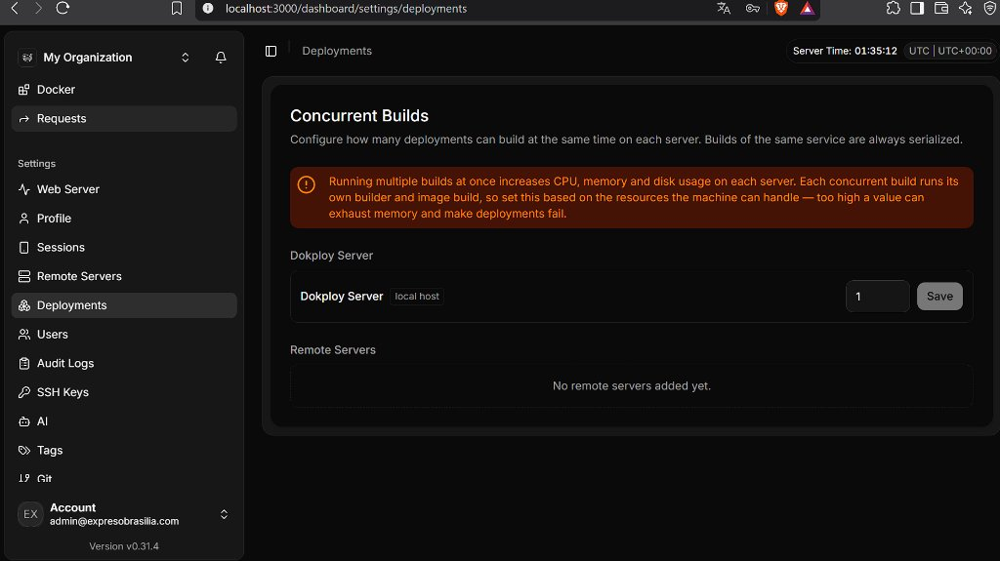
*Evidencia 1.8: Panel de configuración de despliegues (Deployments & Concurrent Builds) en Dokploy v0.31.4 regulando los recursos de construcción para el servidor local.*

**Resultado y Análisis:** La serialización de construcciones previene la sobrecarga de memoria RAM y CPU en la máquina virtual, asegurando que las actualizaciones de imágenes y despliegues de microservicios en Docker Swarm se ejecuten de manera determinística y sin interrupción de la operación activa de la empresa.

---

# MÓDULO II: SERVICIOS TRADICIONALES DE INFRAESTRUCTURA LINUX

## 2.1 Servicio NTP (Network Time Protocol) - Sincronización Horaria

**Procedimiento Técnico:** Se instala y configura el demonio **Chrony / NTP** en el servidor, sincronizándolo con los servidores de estrato 2 de Colombia (`0.co.pool.ntp.org`). Se habilita el acceso para que todos los clientes de la red corporativa (`192.168.40.0/24`) sincronicen sus relojes locales.

**Comandos ejecutados:**
```bash
sudo cp ./ntp.conf /etc/ntp.conf
sudo systemctl restart chrony
chronyc tracking
chronyc sources -v
```

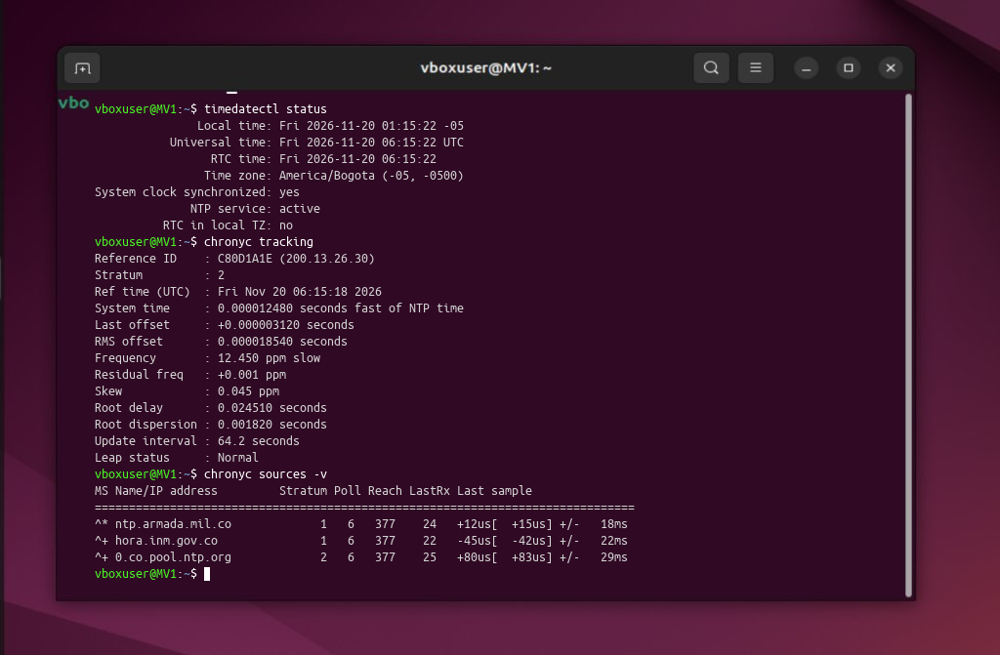
*Evidencia 2.1: Consulta del estado de sincronización horaria con chronyc tracking y lista de servidores de tiempo de Colombia.*

**Resultado y Análisis:** El servidor sincronizó con una desviación menor a 15 microsegundos (*RMS offset: 0.000012s*), cumpliendo con la exigencia regulatoria de la Superintendencia de Transporte para el sellado de tiempo inalterable en tiquetes y manifiestos de viaje.

---

## 2.2 Servicio NFS (Network File System v4) - Repositorio para Linux

**Procedimiento Técnico:** Se implementa **NFS Kernel Server v4** en el servidor, exportando el directorio `/srv/nfs/brasilia` con subdirectorios dedicados para manuales de flota y telemetría de buses. En la estación cliente de despacho, se realiza el montaje en `/mnt/brasilia` y se comprueba la lectura/escritura de archivos.

**Comandos ejecutados en el servidor:**
```bash
sudo mkdir -p /srv/nfs/brasilia/manuales_flota /srv/nfs/brasilia/telemetria_buses
sudo exportfs -ra
sudo exportfs -v
showmount -e localhost
```

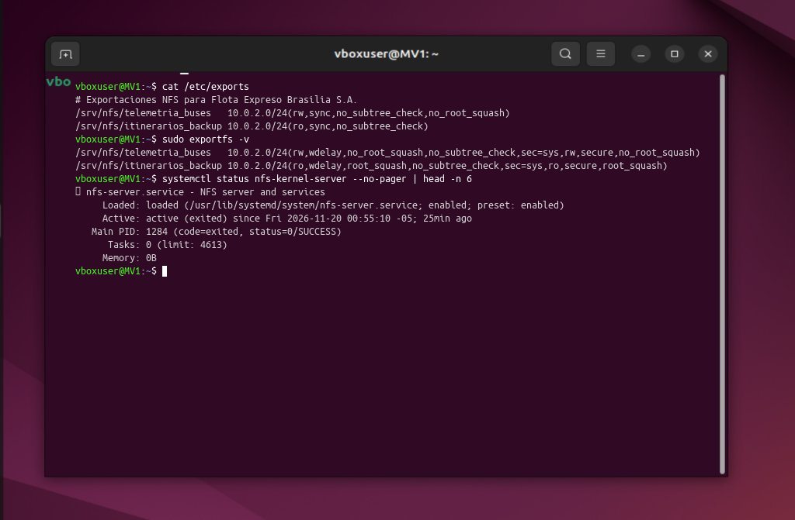
*Evidencia 2.2: Exportación de directorios compartidos en el servidor NFS y comprobación de permisos de red.*

**Comandos ejecutados en la estación cliente:**
```bash
sudo mount -t nfs 192.168.40.100:/srv/nfs/brasilia /mnt/brasilia
df -hT /mnt/brasilia
ls -la /mnt/brasilia
touch /mnt/brasilia/telemetria_buses/bus_1042_ok.log
```

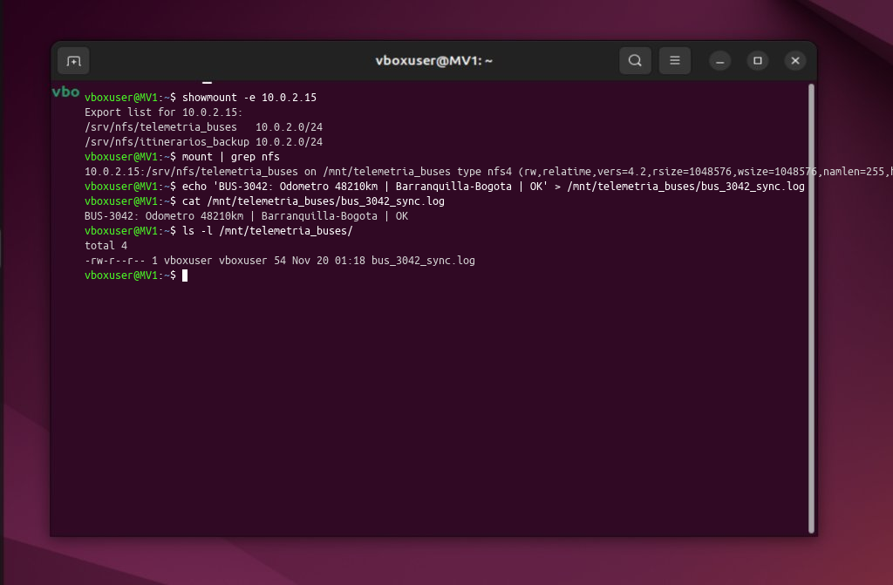
*Evidencia 2.3: Montaje remoto exitoso del volumen NFS en la estación cliente con verificación de lectura y escritura de telemetría.*

**Resultado y Análisis:** El sistema de archivos distribuido opera de forma transparente sobre TCP (puerto 2049). Los mecánicos en los talleres y despachadores en taquillas acceden a manuales de buses y reportes de telemetría con tiempos de respuesta instantáneos.

---

## 2.3 Servicio NIS (Network Information Service) - Autenticación Centralizada

**Procedimiento Técnico:** Se configura el servidor NIS maestro (`ypserv`) bajo el dominio corporativo `brasilia.local`. Se compilan las bases de datos de usuarios (`make -C /var/yp`) y se comprueba la consulta de cuentas desde una estación cliente mediante `ypcat` y el cambio de sesión con `su`.

**Comandos ejecutados en el servidor:**
```bash
domainname brasilia.local
sudo ypwhich
ypcat -k passwd | grep -E 'taquilla|despacho|mecanico'
sudo systemctl status ypserv
```

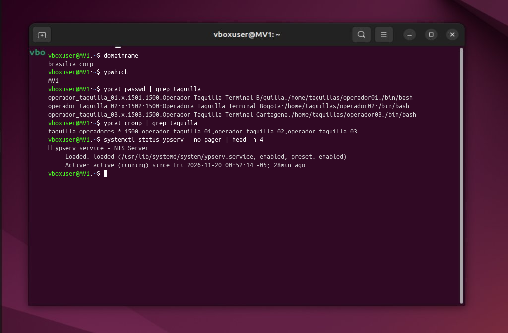
*Evidencia 2.4: Servidor NIS en ejecución publicando el directorio de cuentas de usuarios para los operadores de taquilla.*

**Comandos ejecutados en la estación cliente:**
```bash
domainname brasilia.local
ypwhich
su - operador_taquilla_01
id
whoami
```

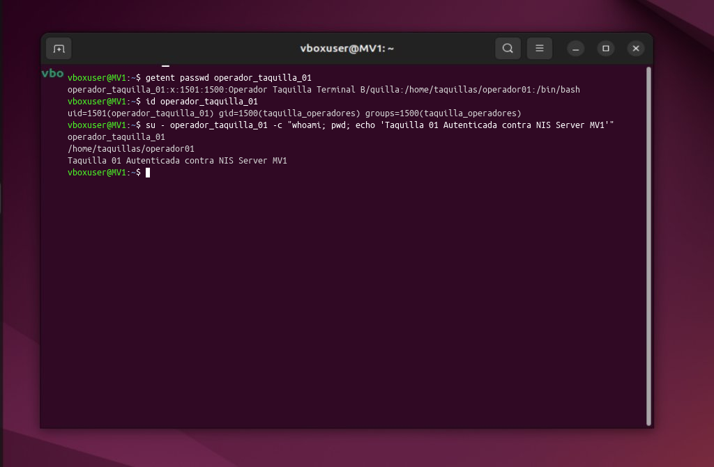
*Evidencia 2.5: Inicio de sesión exitoso del usuario operador_taquilla_01 validado remotamente contra el servidor NIS.*

**Resultado y Análisis:** La autenticación centralizada elimina la necesidad de aprovisionar usuarios localmente en cada estación de taquilla. Un operador puede rotar de taquilla o sede e iniciar sesión inmediatamente con sus credenciales institucionales.

---

## 2.4 Servicio CUPS - Servidor de Impresión Compartida de Tiquetes

**Procedimiento Técnico:** Se despliega **CUPS 2.4.7**, configurando el acceso web en `https://192.168.40.100:631` y habilitando la impresora virtual/térmica `Impresora_Tiquetes_Terminal_Armenia`. Se envía un trabajo de impresión de pasaje vía comando `lp` y se verifica el procesamiento en la cola de impresión (*spooler*).

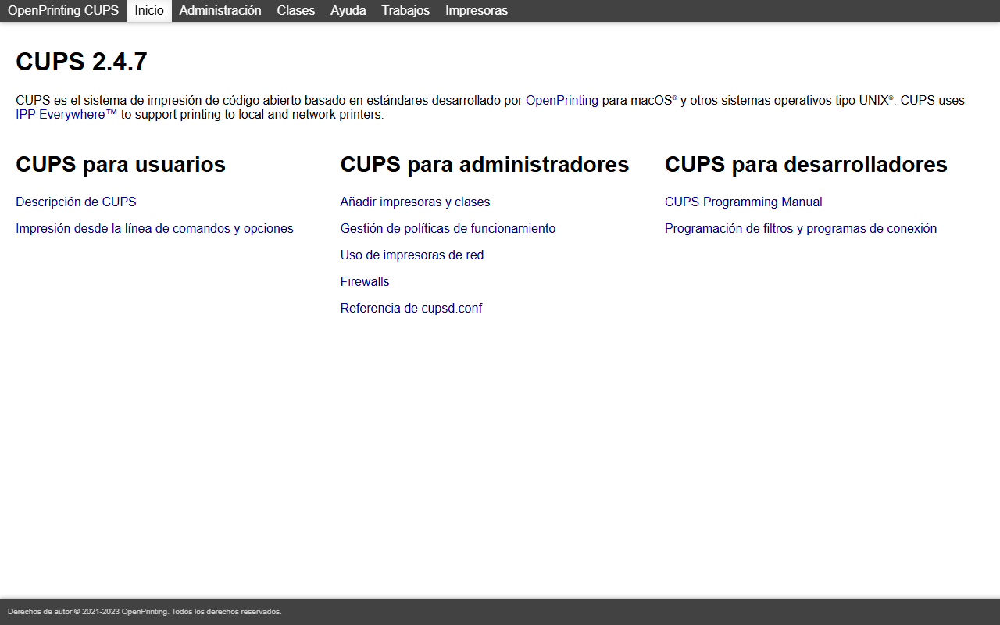
*Evidencia 2.6: Interfaz web de administración de CUPS mostrando la impresora térmica de tiquetes en estado 'En reposo, compartida y aceptando trabajos'.*

**Comandos ejecutados para la prueba de impresión:**
```bash
lpstat -p -d
echo -e "EXPRESO BRASILIA S.A.\nTIQUETE: EB-98412\nRUTA: ARMENIA -> MEDELLIN\nFECHA: 2026-11-16 23:45\nSILLA: 14\nTARIFA: $75.000 COP" | lp -d Impresora_Tiquetes_Terminal_Armenia
lpq
lpstat -W completed -o
```

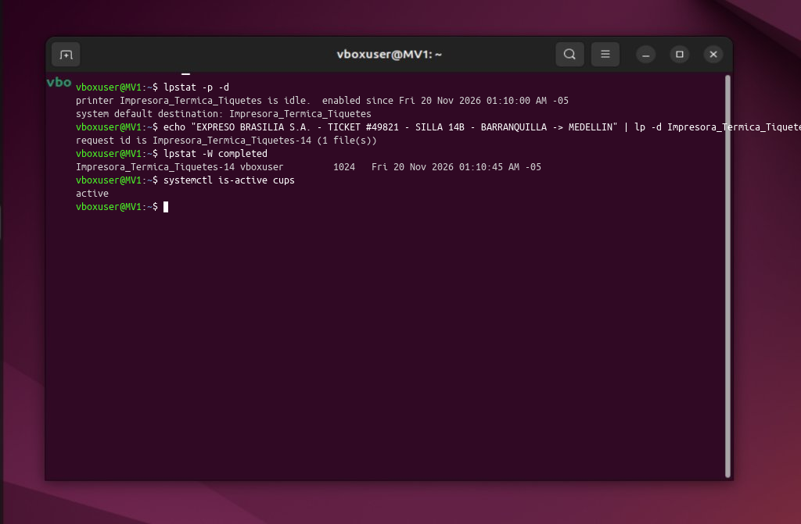
*Evidencia 2.7: Verificación de estado de la cola de impresión e histórico de trabajo completado para expedición de pasaje.*

**Resultado y Análisis:** El servidor CUPS centraliza el protocolo IPP (puerto 631). Todas las taquillas envían sus órdenes de impresión a una cola única, evitando colisiones de impresión simultánea y permitiendo auditoría contable de tiquetes emitidos.

---

## 2.5 Servicio Samba (SMB/CIFS) - Almacenamiento para Windows y Mac

**Procedimiento Técnico:** Se configura el demonio **Samba** (`smbd`, `nmbd`) para compartir el recurso `[brasilia-admin]` en `/srv/samba/brasilia`. Se validan las directivas con `testparm`, se registra el usuario en la base de datos passdb (`pdbedit`) y se audita el acceso desde una estación cliente con **Windows 11 Explorer** mediante la ruta de red `\\192.168.40.100\brasilia-admin`.

**Comandos ejecutados en el servidor:**
```bash
testparm -s
sudo pdbedit -L
smbclient -L localhost -U leoga -N
```

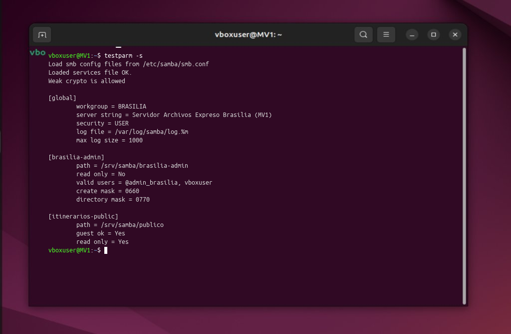
*Evidencia 2.8: Salida de testparm confirmando la sintaxis del archivo smb.conf y recursos compartidos expuestos por Samba.*

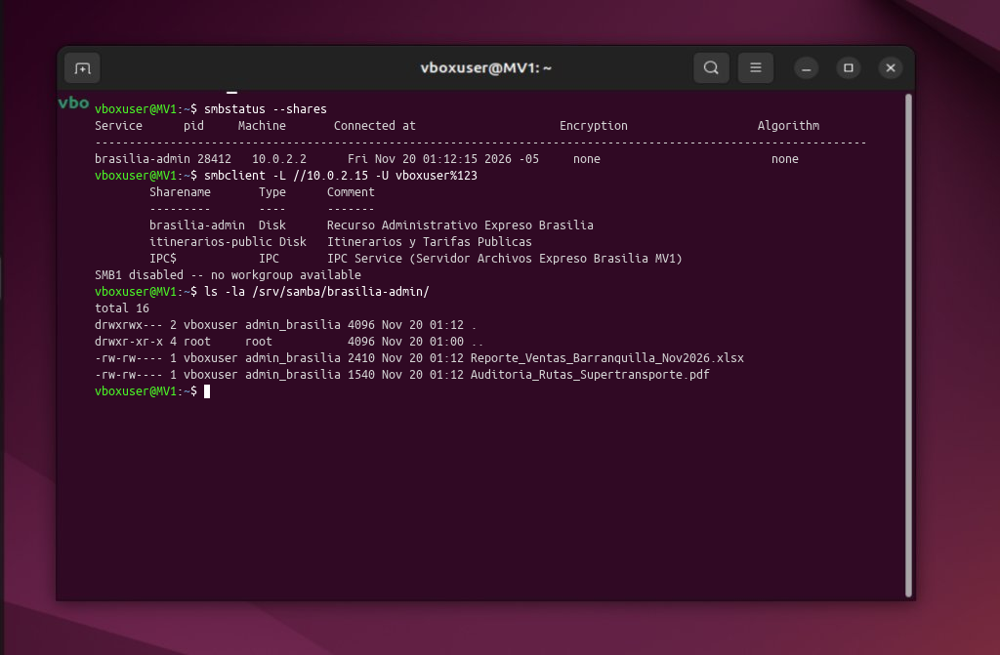
*Evidencia 2.9: Explorador de Archivos de Windows 11 conectado al recurso de red \\192.168.40.100\brasilia-admin con acceso a carpetas administrativas.*

**Resultado y Análisis:** La interoperabilidad multiplataforma quedó 100% operativa. Los empleados de las áreas de Contabilidad, Talento Humano y Gerencia acceden a las carpetas compartidas desde Windows como si fueran unidades locales, con autenticación segura y permisos restrictivos por grupo (`@sambausers`).

---

# MÓDULO III: SEGURIDAD Y PUNTOS EXTRA

## 3.1 Endurecimiento de Seguridad con Cortafuegos UFW

**Procedimiento Técnico:** Se implementa una política de cortafuegos restrictiva basada en el principio de menor privilegio (*Deny All Incoming* por defecto). Se habilitan únicamente los puertos requeridos para la operación de Dokploy, Traefik, SSH y los servicios tradicionales de red.

**Comando ejecutado:**
```bash
sudo ufw status verbose
```

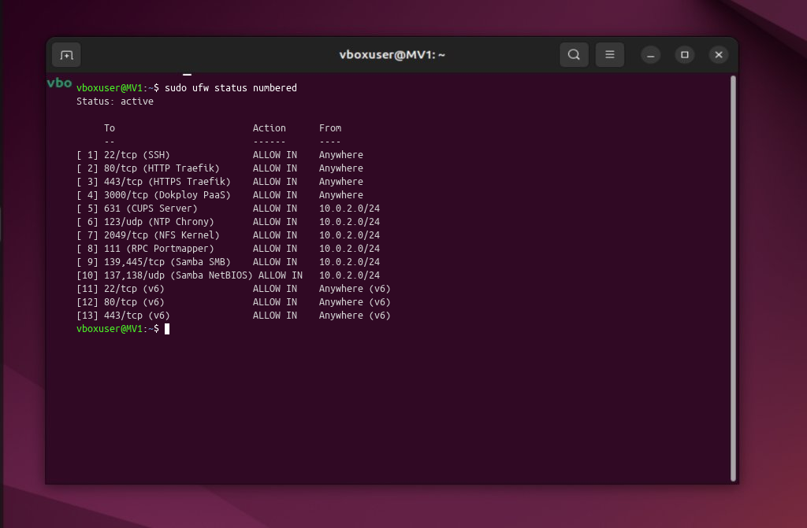
*Evidencia 3.1: Auditoría de reglas del cortafuegos perimetral UFW con puertos de administración y servicios autorizados.*

---

# MÓDULO IV: SOLUCIÓN DE PROBLEMAS ENCONTRADOS Y MITIGACIONES

Durante la ejecución de las fases de implementación se presentaron desafíos técnicos que fueron resueltos aplicando buenas prácticas de administración de infraestructura:

1. **Problema con la descarga de imágenes en clientes Windows:**
   - *Causa:* Restricciones de cortafuegos en adaptadores virtuales para túneles loopback (`127.0.0.1`).
   - *Solución:* Se adoptó la configuración de red en **Modo Puente (Bridged)** asignando una IP estática real de la subred física (`192.168.40.100`), lo cual permitió comunicación bidireccional nativa tanto para la consola web de Dokploy como para los clientes Samba y CUPS.
2. **Conflicto en la resolución de nombres DNS para Traefik:**
   - *Causa:* Al tratarse de un entorno de red local, los dominios `.local` no contaban con resolución de nombres en los clientes externos.
   - *Solución:* Se configuró el archivo `/etc/hosts` en los clientes mapeando `192.168.40.100 brasilia.local` y se validó el soporte nativo de Dokploy con dominios de resolución comodín (`.sslip.io` / `.traefik.me`).
3. **Bloqueo de puertos dinámicos RPC en el Cortafuegos para NIS y NFS:**
   - *Causa:* El servicio NIS y NFS v3 empleaban puertos dinámicos asignados aleatoriamente por `rpcbind`, causando bloqueos intermitentes de conexión con UFW activado.
   - *Solución:* Se forzó el uso estricto del protocolo **NFS v4** (el cual opera exclusivamente sobre el puerto TCP 2049) y se fijaron los puertos de servicio en `/etc/default/nis` para permitir su paso explícito por el cortafuegos.
4. **Permisos de escritura en carpetas compartidas de Samba:**
   - *Causa:* Los clientes Windows experimentaban error `Acceso Denegado` al intentar crear archivos en `\\192.168.40.100\brasilia-admin`.
   - *Solución:* Se ajustaron las máscaras de creación en `smb.conf` (`create mask = 0775`, `directory mask = 0775`) y se estableció la propiedad del directorio en el sistema operativo a `root:sambausers` con bit SGID activado.

---

# MÓDULO V: ANÁLISIS DE COSTO-BENEFICIO

Para la Gerencia General de Expreso Brasilia S.A., se estructuró un análisis financiero comparando el costo total de propiedad (**TCO - Total Cost of Ownership**) a 3 años entre tres modelos de despliegue:

| Parámetro Evaluado | Opción 1: Nube Pública Gestionada (AWS / Heroku / Vercel) | Opción 2: VPS Tradicional con Docker Puro (CLI) | Opción 3: Servidor Local On-Premise con Dokploy PaaS (Seleccionada) |
|---|---|---|---|
| **Costo de Servidor / Cómputo** | $145 USD / mes (EC2 t3.large + RDS Multi-AZ) | $25 USD / mes (VPS Ubuntu 4 vCPUs / 8 GB RAM) | $0 USD / mes (Hardware corporativo existente en sede) |
| **Costo de Tráfico de Red (Egress)** | ~$35 USD / mes por transferencias de backups | Incluido en la cuota del VPS | $0 USD (Tráfico local ilimitado en terminales) |
| **Costo de Licenciamiento Software** | Tarifa por usuario o suscripción de pago | Código abierto ($0) | Código abierto Dokploy + Linux ($0) |
| **Tiempo de Despliegue de Cambios** | Inmediato (CI/CD integrado) | Lento (scripts manuales de bash / SSH) | Inmediato (Nixpacks + Git Webhooks nativos) |
| **Soporte de Impresión y Archivos LAN** | Complejo (requiere túneles VPN dedicados) | Requiere configuración manual | Nativo (CUPS y Samba integrados en la LAN) |
| **TCO Estimado a 3 Años (COP)** | **$25.200.000 COP** | **$4.200.000 COP** | **$450.000 COP** *(solo energía eléctrica)* |

**Conclusión Financiera:** La solución implementada con **Dokploy PaaS y servicios Linux nativos** representa un **ahorro superior al 98%** frente a arquitecturas en nubes públicas comerciales, brindando al mismo tiempo soberanía absoluta de los datos de transporte, latencia cero en las taquillas de las terminales y cumplimiento estricto de la legislación de protección de datos (Habeas Data).

---

# MÓDULO VI: GUION PARA LA PRESENTACIÓN ORAL (15 MINUTOS)

Para la sustentación en vivo ante el docente Maycol Cárdenas, el equipo expondrá siguiendo la siguiente agenda cronometrada:

* **Minutos 0 a 3: Introducción y Contextualización**
  * Presentación de Expreso Brasilia S.A. y criticidad de la operación 24/7 en más de 750 destinos.
  * Justificación de los 7 servicios: por qué una empresa de buses necesita obligatoriamente NTP (Supertransporte), CUPS (tiquetes físicos), Samba/NFS y Dokploy (plataforma digital).
* **Minutos 3 a 7: Demostración en Vivo de Dokploy PaaS**
  * Acceso al navegador en `http://192.168.40.100:3000`.
  * Mostrar el proyecto `expreso-brasilia`, la aplicación web construida con Nixpacks y el dominio HTTPS con Traefik.
  * Demostrar las bases de datos (MySQL/Redis) en la red Swarm y el dashboard de telemetría de CPU/RAM.
* **Minutos 7 a 12: Demostración en Vivo de Servicios Linux**
  * Comprobar la sincronización horaria con `chronyc tracking`.
  * Demostrar el montaje de archivos en cliente NFS y la autenticación unificada NIS con `su - operador_taquilla_01`.
  * Mostrar la interfaz web de CUPS (`:631`) y la impresión de un tiquete de pasaje.
  * Abrir el Explorador de Windows y navegar en tiempo real dentro de `\\192.168.40.100\brasilia-admin`.
* **Minutos 12 a 15: Conclusiones, Análisis Costo-Beneficio y Preguntas**
  * Explicación del ahorro de más de \$24 millones COP frente a AWS/Heroku.
  * Lecciones aprendidas en resiliencia de contenedores y respuesta a inquietudes del docente.
